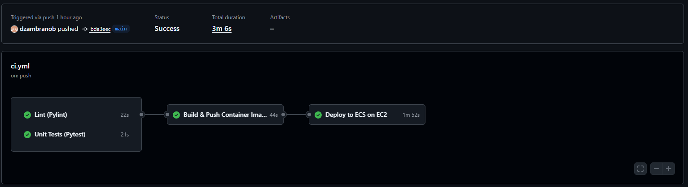
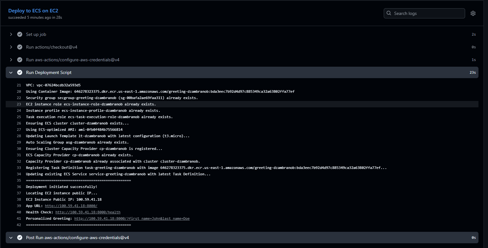
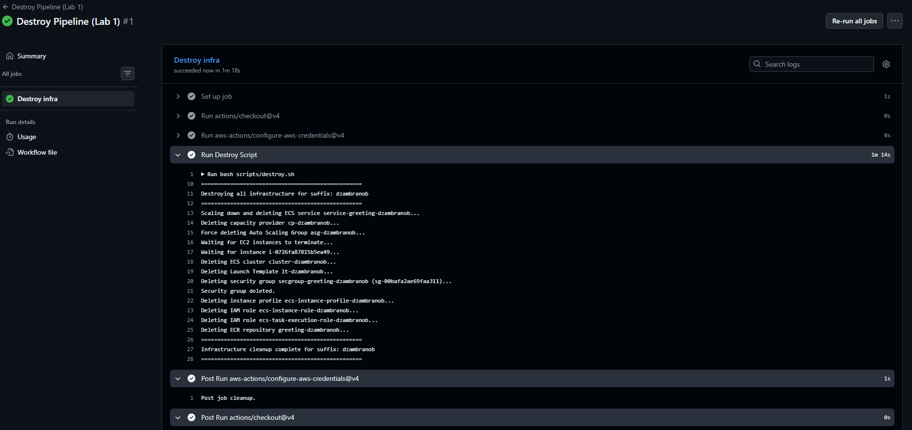
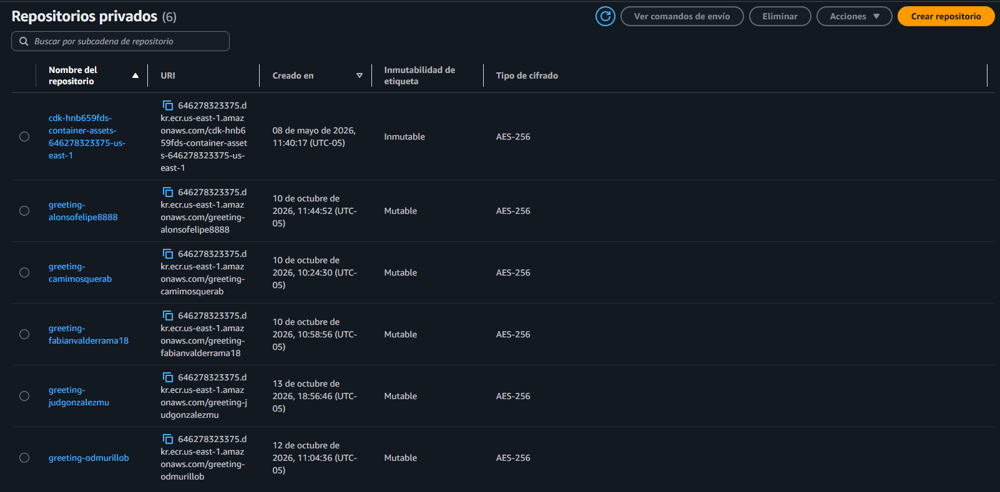
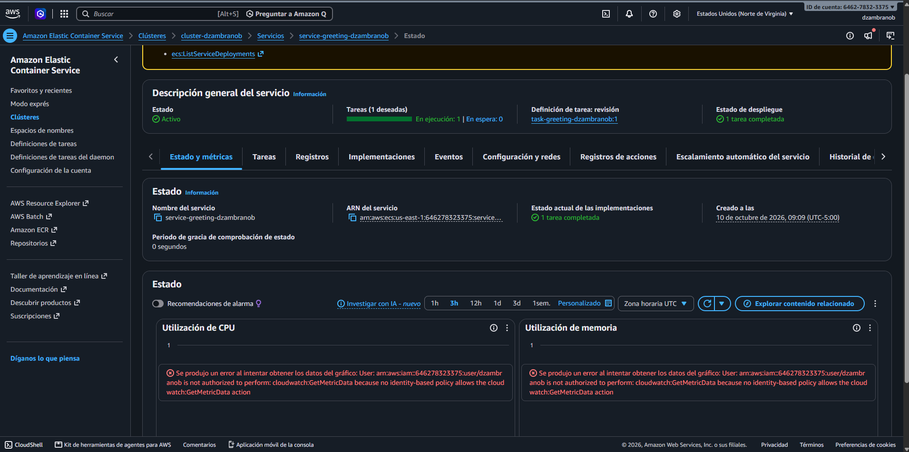
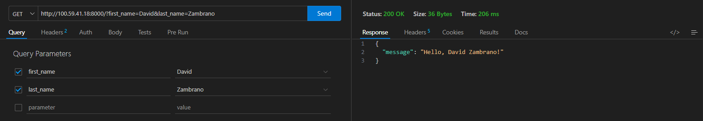

# Lab 01 · CI/CD con GitHub Actions y Amazon ECS

## 1. Arquitectura de contenedores y CI/CD

### Arquitectura de la aplicación

El laboratorio despliega una API de saludos desarrollada con **FastAPI**. La aplicación recibe los parámetros `first_name` y `last_name` en la ruta `/` y devuelve un saludo en formato JSON. También ofrece la ruta `/health` para consultar su estado.

La aplicación se empaqueta en una **imagen Docker** basada en `python:3.12-slim`, que incluye el código y las dependencias administradas con Poetry. Al ejecutar esa imagen se crea un contenedor que inicia Uvicorn en el puerto **8000**. Esto permite distribuir la aplicación junto con su entorno de ejecución y reducir diferencias entre ambientes.

### Integración continua (CI)

La integración continua valida los cambios de código de forma automática. En [ci.yml](../.github/workflows/ci.yml), un `push` o un `pull request` hacia `main` ejecuta dos trabajos en paralelo:

- **Lint con Pylint:** analiza el código de `src` para detectar problemas de calidad.
- **Pruebas con Pytest:** verifican el saludo personalizado, la respuesta sin parámetros y el endpoint `/health`.

Ambos trabajos deben finalizar correctamente antes de construir y publicar la imagen. Esto evita que los cambios que fallen esas validaciones avancen hacia el despliegue.

### Despliegue continuo (CD)

Después de superar las validaciones, un `push` a `main` activa automáticamente la construcción y el despliegue. El flujo también puede iniciarse manualmente con `workflow_dispatch`. Los `pull requests` ejecutan las validaciones, pero no publican ni despliegan la aplicación.

1. **Construcción y publicación:** Docker construye la imagen y la publica en ECR con dos etiquetas: el SHA del commit, para identificar la versión del código, y `latest`.
2. **Configuración de infraestructura:** [deploy.sh](../scripts/deploy.sh) utiliza AWS CLI para crear o reutilizar los recursos necesarios. El sufijo `STUDENT_SUFFIX` permite distinguir los recursos de cada estudiante.
3. **Actualización del servicio:** el script registra una nueva revisión de la definición de tarea con la imagen publicada y crea o actualiza el servicio ECS para ejecutarla.
4. **Verificación funcional:** el script muestra la IP pública cuando está disponible; la respuesta HTTP se comprueba con el navegador, Curl o Postman, como se documenta en el punto 3.

Este flujo conecta los cambios del repositorio con su ejecución en AWS y reduce los pasos manuales. Adicionalmente, [destroy.yml](../.github/workflows/destroy.yml) permite ejecutar manualmente [destroy.sh](../scripts/destroy.sh) para eliminar la infraestructura del laboratorio y evitar mantener recursos innecesarios.

## 2. Ejecución del pipeline

Evidencia visual de la ejecución exitosa del pipeline de GitHub Actions.

### Pipeline automático de despliegue

Se verifica que al hacer un push hacia la rama main, este ejecuta automáticamente el pipeline relacionado con todos los pasos, incluyendo la creación del artefacto y el despliegue automático de este en AWS.

### Pipeline manual de eliminación de infraestructura

Se verifica que el pipeline no se ejecuta automáticamente cuando se hace un pull requet o un push sino solo está habilitado para hacerse manualmente. Además se valida que este pipeline funciona correctamente y ya no se muestra la infraestructura relacionada dentro de la nube.

## 3. Verificación de la petición HTTP

Evidencia visual de la petición HTTP a la IP pública de la instancia EC2 con Postman, Curl o el navegador.

Se verifica que la instancia está iniciada y corriendo, por lo que esta aplicación púede ser alcanzadoa a través del endpoint respectivo, en este caso se hace la prueba con la petición `get` hacia el endpoint `"http://<EC2_PUBLIC_IP>:8000/?first_name=TuNombre&last_name=TuApellido"` con los parámetros de `first_name=David` y `last_name=Zambrano`

## 4. Propuestas para mejorar el pipeline

Estas propuestas se enfocan en mejorar la ejecución y el control del pipeline, conservando la arquitectura de la aplicación, la forma en la que se crea el contenedor Docker y el despliegue con los componentes actuales.

- Verificar automáticamente el resultado del despliegue

Actualmente, el script solicita el despliegue y muestra la IP pública cuando está disponible. Se propone agregar un paso que espere la estabilidad del servicio  y luego consulte `/health` y la ruta de saludo. Las peticiones deben tener reintentos y un tiempo máximo de espera, validando tanto el código HTTP como el contenido esperado. Así, el pipeline solo finalizaría correctamente después de comprobar que la aplicación responde. 

- Reducir tiempos con caché de dependencias

Los trabajos de lint y pruebas instalan Poetry y las dependencias en cada ejecución. Se propone reutilizar la caché de dependencias con una clave basada en el sistema operativo, la versión de Python y el contenido de `poetry.lock`. Esto reduciría descargas repetidas sin cambiar las versiones declaradas por el proyecto. 

- Validar los parámetros antes de modificar recursos

Agregar una validación inicial de `STUDENT_SUFFIX`, la región y la identidad de AWS utilizada. El sufijo debería cumplir un formato definido y mostrarse junto con la cuenta y región de destino en el resumen de ejecución. Para el flujo manual de eliminación, se propone solicitar además que se escriba el sufijo como confirmación y comprobar que coincide con el objetivo. Esto ayudaría a detectar errores antes de crear o eliminar infraestructura.

- Mejorar la reproducibilidad y las validaciones previas

Fijar la versión de Poetry y las revisiones de las acciones utilizadas para evitar cambios inesperados en las herramientas del pipeline. Además, se propone validar la sintaxis de los workflows y de los scripts Bash, y ejecutar pruebas HTTP contra el contenedor construido antes de publicarlo. Esto permitiría detectar problemas de empaquetado o arranque que las pruebas unitarias por sí solas no cubren.